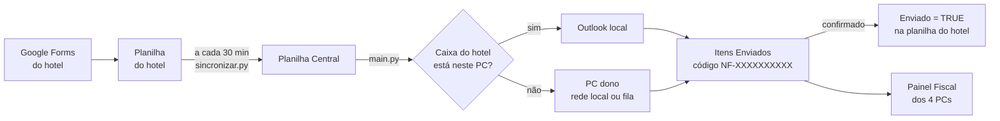

# Notas Fiscais — Rede Andrade

[](https://github.com/Kaereze/Notas-Fiscais/actions/workflows/testes.yml)

Automação das solicitações de nota fiscal dos hotéis da rede, usada pela equipe fiscal em 4 PCs com Windows.
Tem duas partes:

- **Robô Solicitações NF**: lê os pedidos de NF que os hóspedes fazem no Google Forms, junta tudo na
  Planilha Central e manda **um e-mail por hotel**, sempre pela caixa do próprio hotel, no PC dono dela.
- **Painel Fiscal**: o aplicativo de cada agente. Funciona como espelho ao vivo do Outlook dos 4 PCs, com
  caixa de entrada, itens enviados, notas fiscais, urgências e gerência no mesmo layout. Desde 20/10/2026 tem o visual
  do Outlook escuro: e-mail e formulário iguais ao Outlook, pesquisa instantânea e envio sem espera
  ([Guia do Painel Fiscal](Segundo%20C%C3%A9rebro/6%20Documentos/Guia%20do%20Painel%20Fiscal.md)).

## Como funciona



O que o projeto garante:

| Garantia | Como |
|---|---|
| Nunca envia duas vezes | Anota antes de enviar (`estado/envios_pendentes.json`) e confere o código `NF-…` em Itens Enviados antes de tentar de novo |
| TRUE só depois do envio confirmado | A coluna "Enviado" da planilha do hotel só é marcada quando o e-mail aparece em Itens Enviados. É a única escrita nas planilhas dos hotéis |
| Remetente certo | Cada e-mail sai da caixa do próprio hotel, no PC dono dela (`src/envio_pc_dono.py`). PC desligado = não envia e tenta na próxima rodada |
| Cota do Google respeitada | Cada programa tem uma fatia fixa: 57 de 60 leituras por minuto somando os 4 PCs (`src/cota_google.py`) |
| Pode desligar | Aba Status, célula B1 desmarcada: nada é enviado |

## Estrutura

```text
robo.py              entrada do envio manual
config.json          configuração comum (modo, pastas, colunas)
src/                 código do robô e do Painel (Python)
  main.py            robô de envio
  sincronizar.py     cópia das planilhas dos hotéis para a Central
  envio_pc_dono.py   envio pela caixa do hotel no PC dono
  app_servidor.py    servidor local do Painel (127.0.0.1) e rede entre os PCs
  espelho_emails.py  espelho do Outlook de cada PC
app_ui/              telas do Painel Fiscal (HTML, CSS, JS)
apps_script/         menu da Planilha Central (Google Apps Script)
Automacoes/          agendamentos do Windows (.ps1)
Bat/                 atalhos (.bat)
ferramentas/         travas de entrega (pre-commit e guarda do git)
testes/              testes automáticos (pytest)
Segundo Cérebro/     documentação completa (cofre do Obsidian)
```

Ficam só no PC e **nunca** vão para o GitHub: `estado/` (memória do robô), `logs/`, `config.local.json` e
qualquer credencial.

## Começar

Num PC do trabalho (Windows, com Outlook e a chave do Google instalada):

```bat
INSTALAR_OU_ATUALIZAR.bat
```

Num PC fora do trabalho, sem Outlook dos hotéis e sem a chave, use `PAINEL_DEMO_EM_CASA.bat` (dados fictícios).

Requisitos: Python 3.14 e as dependências de `requirements.txt` (`pywin32`, `gspread`, `google-auth`, `pypdf`,
`pywebview`, `pytest`).

## Qualidade e entrega

| Etapa | O que acontece |
|---|---|
| Antes do commit | `.githooks/pre-commit` barra credenciais, `estado/`, `logs/` e CPF de hóspede real, roda o ruff e todos os testes. Ligar uma vez no PC: `git config core.hooksPath .githooks` e `pip install -r requirements-dev.txt` |
| No GitHub | A cada push em `main`, `Bernardo`, `Christian` ou `clara`, o GitHub Actions roda o ruff e os testes no Windows ([testes.yml](.github/workflows/testes.yml)) |
| Padrão do código | [`ruff.toml`](ruff.toml): só erro real (sintaxe, nome indefinido, import sem uso) |
| Versões | Uma por dia de entrega (`AAAA.MM.DD`), com etiqueta no git: ver [CHANGELOG.md](CHANGELOG.md) |
| Testes | `python -m pytest -q`: inclui a trava contra vazamento de credenciais (`testes/test_segredos.py`) |
| Entrega | `git push origin main main:Bernardo main:Christian main:clara` e depois "Atualizar todos os PCs" no Painel |

## Segurança

- Credenciais (chave do Google, senhas, tokens) ficam só no PC, fora do repositório. O `.gitignore`, o
  pre-commit e os testes impedem que subam.
- O Painel só atende em `127.0.0.1`, com token. A rede entre os PCs (porta 8766) é assinada e liberada só para
  a rede local.
- Planilhas dos hotéis e do Mail Analytics são **só leitura**. A única escrita é o TRUE na coluna "Enviado"
  depois de um envio confirmado.
- Dados de hóspedes (nome, CPF, e-mail) não aparecem em telas de exemplo, testes ou documentação. O pre-commit
  compara os CPFs do commit com os CPFs reais do PC e barra se achar um.

## Documentação

Tudo fica no **Segundo Cérebro**, o cofre do Obsidian dentro deste repositório:

| Para… | Abra |
|---|---|
| Começar (onde paramos, próximos passos) | [`0 Comece aqui/00 Início.md`](Segundo%20C%C3%A9rebro/0%20Comece%20aqui/00%20In%C3%ADcio.md) |
| Regras e o que não mexer | [`1 Regras/`](Segundo%20C%C3%A9rebro/1%20Regras/) |
| Visão técnica do robô (fluxo, garantias) | [`6 Documentos/README técnico.md`](Segundo%20C%C3%A9rebro/6%20Documentos/README%20t%C3%A9cnico.md) |
| **Guia do Painel Fiscal** (cada tela, pesquisa, envio, atalhos) | [`6 Documentos/Guia do Painel Fiscal.md`](Segundo%20C%C3%A9rebro/6%20Documentos/Guia%20do%20Painel%20Fiscal.md) |
| **Se o robô parar** (manual de incidentes) | [`6 Documentos/Se o robô parar.md`](Segundo%20C%C3%A9rebro/6%20Documentos/Se%20o%20rob%C3%B4%20parar.md) |
| Dados de hóspedes (LGPD): onde ficam, por quanto tempo | [`6 Documentos/Dados de hóspedes (LGPD).md`](Segundo%20C%C3%A9rebro/6%20Documentos/Dados%20de%20h%C3%B3spedes%20%28LGPD%29.md) |
| Instalar um PC, tarefas do Windows, pendências | [`6 Documentos/Instalação e pendências.md`](Segundo%20C%C3%A9rebro/6%20Documentos/Instala%C3%A7%C3%A3o%20e%20pend%C3%AAncias.md) |
| PC de casa | [`2 Como trabalhar/Painel em casa.md`](Segundo%20C%C3%A9rebro/2%20Como%20trabalhar/Painel%20em%20casa.md) |

Projeto interno da Rede Andrade.
