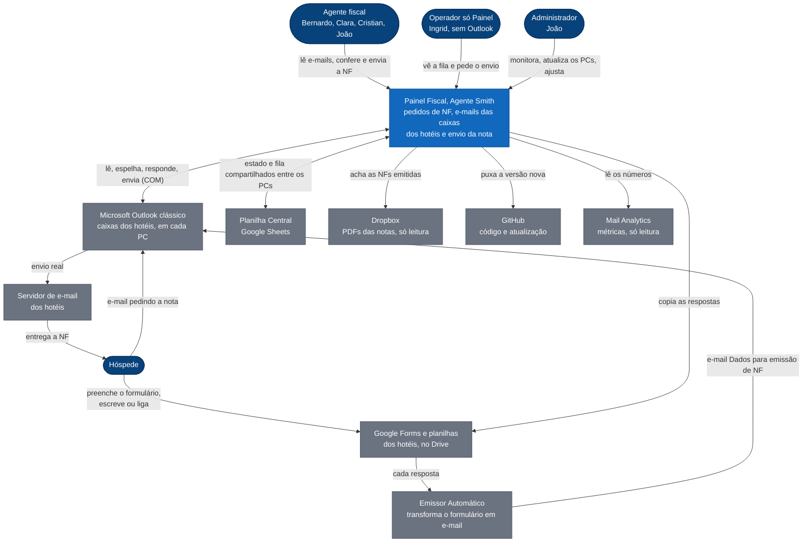
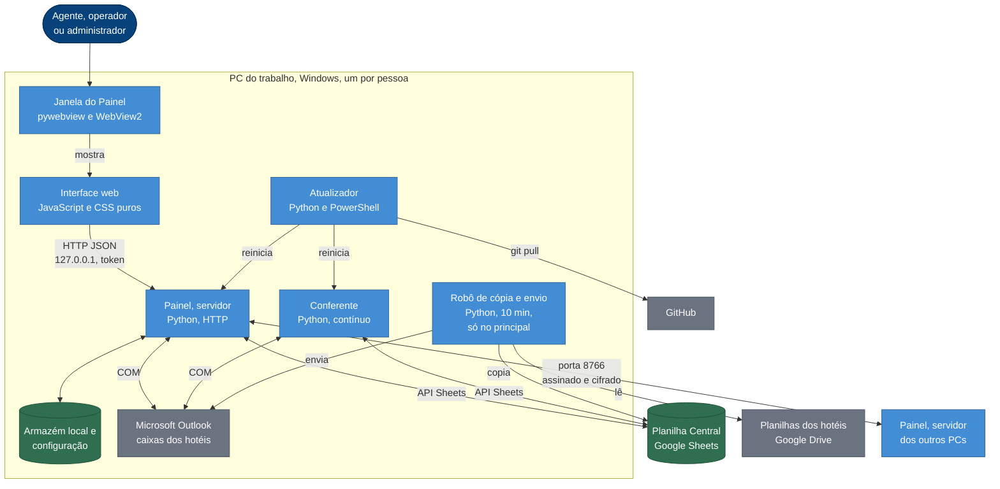
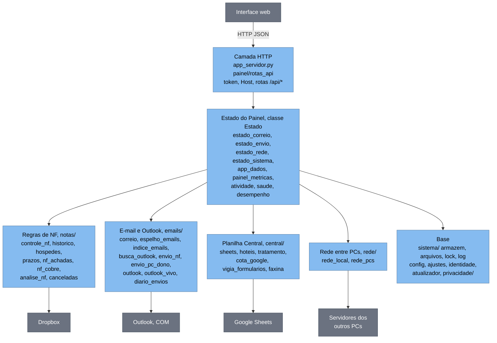
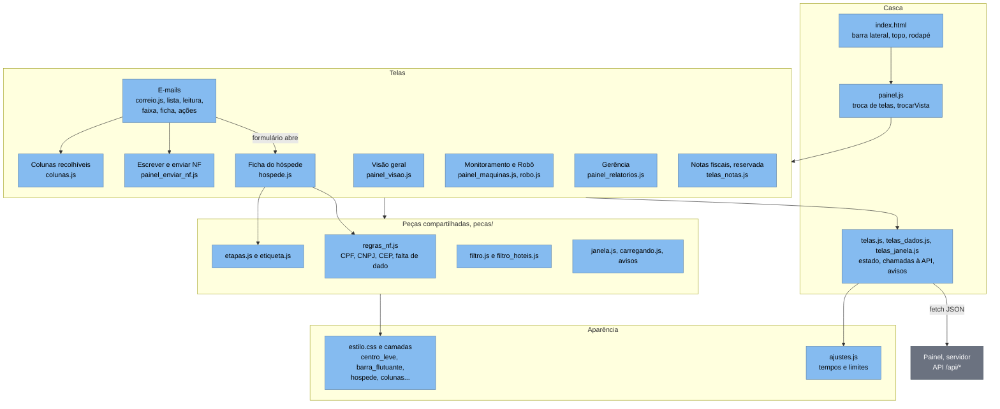
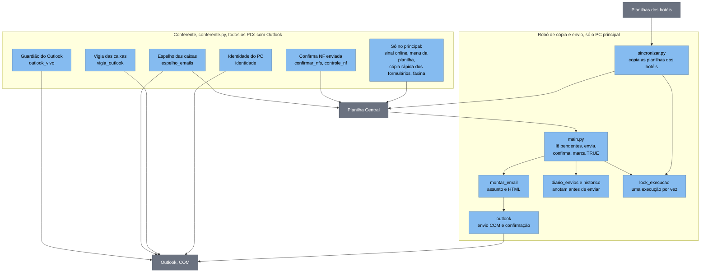

# Arquitetura do Painel Fiscal (modelo C4, níveis 1, 2 e 3)

O modelo C4 descreve o sistema em zoom crescente: **1. Contexto** (quem usa e com o que fala), **2. Contêineres** (os programas e armazéns que rodam), **3. Componentes** (as peças dentro de cada programa). Os diagramas abaixo são Mermaid: o Obsidian e o GitHub desenham sozinhos. Versão visual: Artifact "Arquitetura C4 do Painel Fiscal".

> Mapas de apoio, gerados do código: [[Módulos por pasta]], [[Planilhas e abas]], [[Pessoas e PCs]], [[API do Painel]]. Regras e proibições: [[O que não mexer]], [[Credenciais]].

---

## Nível 1: Contexto do sistema

**O que é o sistema:** o **Painel Fiscal (Agente Smith)** recebe os pedidos de nota fiscal dos hóspedes da Rede Andrade, mostra os e-mails das caixas dos hotéis dos 4 PCs num lugar só e envia a NF ao hóspede, sempre pela caixa do próprio hotel. É a evolução do robô "Solicitações NF".

### Pessoas

| Quem | O que faz no sistema |
|---|---|
| Agente fiscal (Bernardo, Clara, Cristian, João) | Cada um usa o Painel no seu PC, com o Outlook das caixas dos seus hotéis. Vê a fila, confere os dados, emite a NF fora do Painel e envia pelo Painel. |
| Operador só Painel (Ingrid) | Painel sem Outlook: vê a fila e **pede** o envio; quem envia é o PC dono da caixa. |
| Administrador (João) | Tudo do agente, mais Monitoramento, Agentes do Smith, atualizar os PCs e ajustes. O PC principal também faz a cópia das planilhas e a faxina. |
| Hóspede | Pede a NF por formulário, e-mail ou telefone e recebe a nota por e-mail. |

### Sistemas externos

| Sistema | Papel | Como o Painel fala com ele |
|---|---|---|
| Google Forms e planilhas dos hotéis | Onde o hóspede preenche; cada hotel tem sua planilha de respostas | API do Google Sheets e Drive, só leitura (marca TRUE em Enviado depois do envio) |
| Emissor Automático | Gera o e-mail "Dados para emissão de Nota Fiscal" a partir do formulário | Chega como e-mail comum na caixa do hotel |
| Microsoft Outlook clássico | Guarda as caixas dos hotéis e envia o e-mail de verdade | COM (pywin32), só no Windows, no PC dono da caixa |
| Planilha Central (Google Sheets) | "Banco" compartilhado entre os 4 PCs: fila, comandos, espelhos de e-mail, atividade | API do Google Sheets, cota de 60 leituras por minuto somando os 4 PCs |
| Dropbox | Pastas com os PDFs das notas emitidas | Leitura de arquivos locais sincronizados |
| GitHub (`Kaereze/Agente-Smith`) | Código e versões (etiquetas) | `git pull` pelo atualizador |
| Mail Analytics | Planilha de métricas por agente (Apps Script) | Só leitura |

---

## Nível 2: Contêineres

"Contêiner" aqui é um programa ou armazém que roda ou guarda dados. Cada PC do trabalho roda o mesmo código, com **papéis** diferentes definidos em `config.local.json`: `principal`, `conferente` ou `so_painel`.

| Contêiner | Tecnologia | Responsabilidade | Roda em |
|---|---|---|---|
| Janela do Painel | Python, pywebview, WebView2 | Aplicativo próprio que mostra a interface sem navegador | Todos |
| Interface web | HTML, JavaScript e CSS puros (sem framework, sem etapa de compilação) | Todas as telas: Visão geral, E-mails, Ficha do hóspede, Monitoramento, Gerência | Todos (servida pelo servidor) |
| Painel, servidor | Python, `http.server`, porta 127.0.0.1 e 8766 na rede local | API da tela, lê a Central, fala com Outlook e com os outros PCs, guarda o estado | Todos (tarefa `SolicitacoesNF_Painel`) |
| Conferente | Python, pywin32 | Mantém o Outlook aberto, espelha as caixas, marca as etiquetas das NFs. No principal também publica o sinal, atende o menu da planilha, copia formulários e faz a faxina | Principal e conferentes (não no só Painel) |
| Robô de cópia e envio | Python | Copia as respostas dos hotéis para a Central e envia as solicitações pendentes, confirmando em Itens Enviados antes de marcar TRUE | Só o PC principal (tarefa de 10 min) |
| Atualizador e reinício | Python, PowerShell, Agendador do Windows | Mantém o código igual ao do GitHub (só até a última etiqueta no automático) e reinicia os serviços | Todos |
| Armazém local | Arquivos JSON e cache em `estado/`, registros em `logs/` | Memória deste PC; o catálogo de tudo que é gravado está em `sistema/armazem.py` | Todos |
| Planilha Central | Google Sheets | Barramento e "banco" entre os PCs (abas `PCs_Painel`, `Comandos_PC`, `Correio_<PC>`, `Envios_NF`...) | Nuvem |

### Fluxos principais

1. **Pedido do hóspede até a NF enviada:** formulário preenchido → planilha do hotel → o robô (ou a cópia rápida) copia para a Central → o pedido aparece no Painel; o Emissor Automático também manda o e-mail para a caixa do hotel → o espelho do Conferente leva o e-mail para a Central → o agente abre a **ficha do hóspede**, emite a NF fora do Painel, anexa e envia → o pedido de envio vai para a fila `Envios_NF` → o **PC dono da caixa** envia pelo Outlook e confirma em Itens Enviados.
2. **Pesquisa de e-mail ao vivo:** a tela pergunta, pela rede local (porta 8766, assinada e cifrada), ao Outlook de cada PC ligado; o índice local responde na hora e a busca direta completa depois.
3. **Atualizar todos os PCs:** o botão grava um comando em `Comandos_PC`; cada PC faz `git pull` (só se não houver arquivo alterado à mão) e reinicia; a etiqueta controla o que o automático traz.

---

## Nível 3: Componentes

### 3a. Painel, servidor (`src/`)

| Grupo | O que faz | Onde mexer (como o cofre orienta) |
|---|---|---|
| Camada HTTP | Recebe a chamada da tela, confere o token e o Host, despacha pela tabela de rotas | `app_servidor.py`, `painel/rotas_api.py` |
| Estado do Painel | O objeto que a tela consulta: junta Central, e-mails, rede e saúde. Está dividido em mixins por assunto | `painel/estado_*.py`, `painel/app_dados.py` |
| Regras de NF | O que conta como NF pronta, casar nota e pedido, prazo, hóspede repetido, urgência | `notas/` |
| E-mail e Outlook | Espelho, índice e busca; envio pelo PC dono da caixa; guarda o Outlook aberto; anota antes de enviar para nunca duplicar | `emails/` |
| Planilha Central | Ler e gravar abas respeitando a cota do Google; cadastro de hotéis; faxina | `central/` |
| Rede entre PCs | Pedido assinado e cifrado pela porta 8766; comandos pela aba `Comandos_PC` | `rede/` |
| Base | Gravação atômica, trava entre processos, ajustes, atualização, LGPD | `sistema/`, `privacidade/` |

### 3b. Interface web (`app_ui/`)

A tela é **JavaScript puro**: cada arquivo é carregado por `<script>` no `index.html`, na ordem; não há compilador nem framework. Toda regra de negócio pesada fica no Python; a tela só chama a API e desenha.

### 3c. Conferente e robô de cópia e envio

**Garantias do envio:** o `TRUE` só entra depois de o e-mail aparecer em Itens Enviados (código `NF-XXXXXXXXXX` no rodapé); o envio é anotado **antes** de sair (`estado/envios_pendentes.json`), então uma queda no meio não gera duplicidade; cópia, envio e conferência nunca rodam ao mesmo tempo.

---

## Papéis de cada PC

| Papel | Quem | Roda | Não roda |
|---|---|---|---|
| `principal` | João (`DESKTOP-GA8IJAU`) | Painel, Conferente completo, robô de cópia e envio, faxina | |
| `conferente` | Bernardo, Clara, Cristian | Painel e Conferente (espelho, etiquetas, Guardião do Outlook) | Cópia, envio pelo robô, faxina |
| `so_painel` | Ingrid, e este PC de acompanhamento | Painel | Conferente e Guardião, Outlook automático, cópia |

## Limites e decisões que moldam a arquitetura

- **Só Windows:** falar com o Outlook clássico exige COM (pywin32). Isso mantém o servidor em Python; a tela é que pode mudar de tecnologia sem afetar isso.
- **Cota do Google:** 60 leituras por minuto somando os 4 PCs, dividida em `cota_google.py`. Toda leitura nova entra na conta.
- **Sem banco de dados próprio:** a Planilha Central faz esse papel; o estado local é arquivo JSON gravado de forma atômica.
- **Segurança:** a API da tela só atende `127.0.0.1` com token; entre PCs, pedido assinado com segredo e conteúdo cifrado; chaves ficam em `%APPDATA%\SolicitacoesNF`, nunca no repositório; acessos a dado de hóspede são registrados (LGPD).
- **Atualização por etiqueta:** o automático só vai até a última etiqueta; PCs com arquivo alterado à mão recusam atualização.
- **A aba "Notas fiscais" está reservada** para a futura emissão automática de NF; nada manda para ela.

Voltar: [[00 Início]]
